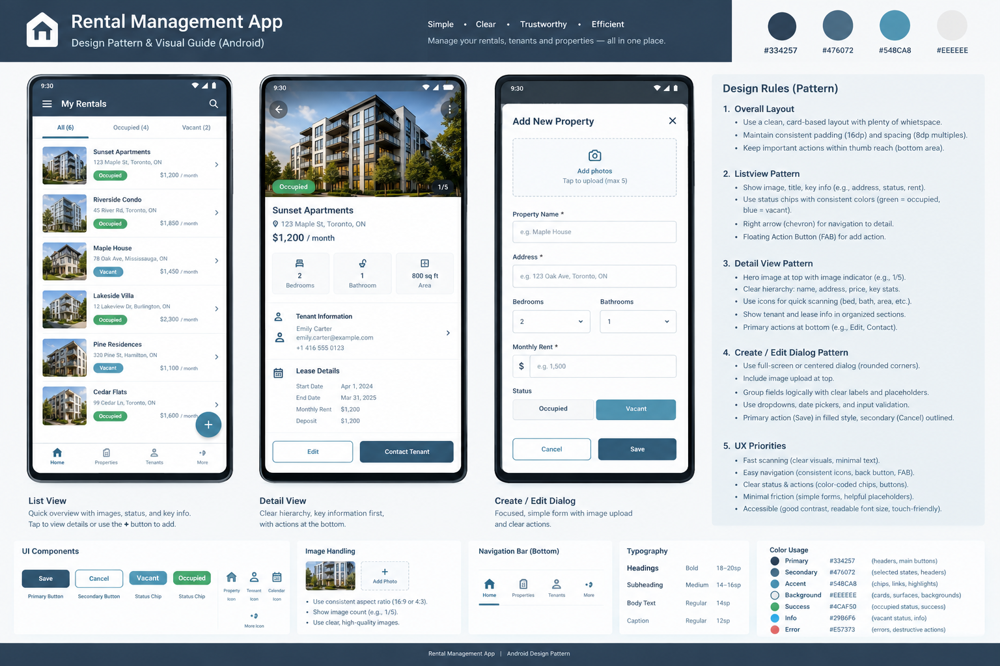

# Rental Management App — Android Design Pattern

**Purpose:** A reusable UI/UX specification for AI-assisted design and implementation of a rental management application on Android.

**Status:** Initial design baseline. Use this document as the default for every new screen unless a documented usability or platform constraint justifies an exception.

**Product assumption:** The primary user is a landlord or property manager managing properties, rental units, tenants, leases, rent, and maintenance. The app is mobile-first and uses a consistent, professional visual language.

## 1. Visual reference

Use this concept board as a visual direction reference, not as a pixel-perfect specification. Follow the written rules below whenever the image conflicts with them.

## 2. Design principles

1. **Make operational information scannable.** Property/unit identity, occupancy, rent, payment status, and important dates should be easy to locate.
2. **Use one consistent system.** Reuse shared tokens and components across Properties, Units, Tenants, Leases, Payments, and Maintenance.
3. **Reveal complexity progressively.** Show the most important information first; keep secondary data in named sections, secondary screens, or expandable groups.
4. **Keep actions predictable.** Use consistent placement and wording for Add, Edit, Save, Cancel, Delete, and navigation.
5. **Prevent avoidable data loss.** Preserve form inputs through validation failures, show save state, and confirm before discarding meaningful unsaved work.
6. **Design for accessibility.** Never rely on color alone, support larger system font settings, and provide appropriately sized touch targets.
7. **Prefer native Android behavior.** Use Material 3 components and established Android navigation, keyboard, back, and system-bar behavior rather than inventing custom interaction patterns without a clear benefit.

## 3. Color tokens

The four brand colors are the core palette and must remain consistent throughout the app. Use white as a neutral surface color; do not introduce additional decorative brand colors.

| Token | Hex | Use |
|---|---|---|
| `colorPrimary` | `#334257` | Primary buttons, app-bar content or container as appropriate, page titles, key icons, high-priority actions |
| `colorSecondary` | `#476072` | Secondary actions, supporting labels, outlines, subdued navigation elements |
| `colorAccent` | `#548CA8` | Selected tabs/filters, focus indicators, links when contrast permits, progress, selected controls, decorative highlights |
| `colorBackground` | `#EEEEEE` | App canvas and neutral background areas |
| `colorSurface` | `#FFFFFF` | Cards, form surfaces, dialogs, sheets, and readable content areas |
| `colorTextPrimary` | `#334257` | Main content text and headings |
| `colorTextSecondary` | `#476072` | Supporting text when it remains readable |
| `colorOutline` | `#D5D9DE` | Dividers, field borders, and subtle boundaries; use only where a boundary is needed |
| `colorOnPrimary` | `#FFFFFF` | Text and icons placed on the primary color |

### Color usage rules

- Keep the main canvas light and calm. Use white surfaces to separate functional groups from `#EEEEEE`.
- Use the primary color for the most important action on a screen. Do not render every button as primary.
- Use the accent to communicate selection or interaction, not as a replacement for readable body text.
- Do not use `#548CA8` for small text on `#EEEEEE` or white: its contrast is approximately 3.18:1 against `#EEEEEE` and 3.69:1 against white. Use `#334257` or `#476072` for normal-size text. Accent may be used for larger text or non-text controls when the relevant contrast requirement is met.
- Approximate contrast ratios: `#334257` on `#EEEEEE` = 8.80:1; `#476072` on `#EEEEEE` = 5.68:1. These combinations are suitable for normal text under WCAG AA contrast thresholds.
- Status colors (for example, success, warning, and error) are semantic tokens, not extra brand colors. Add them only where status recognition materially benefits the user. Pair every status color with text and/or an icon. Never communicate `Occupied`, `Vacant`, `Overdue`, or `Maintenance` by color alone.
- Do not apply the accent to all interactive elements simultaneously. Preserve clear hierarchy between primary action, secondary action, and passive information.

## 4. Layout, spacing, and typography

Use these as starting design tokens. Keep them centralized and adjust only when needed for an established Android component or accessibility.

| Token | Baseline |
|---|---:|
| `space4` | 4 dp |
| `space8` | 8 dp |
| `space12` | 12 dp |
| `space16` | 16 dp |
| `space24` | 24 dp |
| `space32` | 32 dp |
| Screen horizontal padding | 16 dp |
| Gap between related fields | 12–16 dp |
| Gap between distinct sections | 24 dp |
| Standard card corner radius | 12 dp |
| Field/button corner radius | 8–12 dp |
| Standard icon size | 24 dp |
| Minimum interactive touch target | 48 × 48 dp |

### Typography

Use the default Android sans-serif / Material 3 type system. Treat sizes as nominal starting values; use semantic typography roles instead of individually styling every text element.

| Role | Size | Weight / rule |
|---|---:|---|
| Screen title | 22–24 sp | Medium or semibold |
| Section title | 18–20 sp | Medium or semibold |
| Item title | 16 sp | Medium |
| Body / field content | 16 sp | Regular |
| Supporting metadata | 14 sp | Regular |
| Caption / compact hint | 12 sp | Regular; avoid using for essential data |

- Use `dp` for dimensions and spacing, and `sp` for text.
- Support font scaling. Do not fix container heights in a way that clips enlarged text.
- Prefer start alignment for labels and content. Align comparable currency values and dates consistently.
- Use sentence case for labels and buttons. Write specific action labels such as **Save property** when plain **Save** would be ambiguous.
- Avoid long all-caps headings, excessive bold text, unnecessary dividers, heavy shadows, and nested cards.

## 5. App shell and navigation

- Use a Material 3 `Scaffold` (or the corresponding structure for the existing UI toolkit) to manage app bars, content, bottom navigation, and floating actions.
- On phones, use bottom navigation only for the app's small set of highest-priority destinations, such as **Overview**, **Properties**, **Tenants**, and **Payments**. Put less frequent destinations such as Settings, Reports, and Maintenance in an appropriate secondary location if needed.
- Do not add a separate bottom navigation bar to modal forms or detail flows where it competes with task actions.
- The top app bar should show the current destination or record title, a back action when appropriate, and only relevant actions. Avoid filling the bar with multiple competing icons.
- Use a FAB only when there is one clear, frequent, contextual create action. Otherwise use a visible text/button action such as **Add property** or **Record payment**.
- Respect status bars, navigation bars, cutouts, edge-to-edge insets, and keyboard insets. Content and primary actions must not be hidden behind system UI.
- On wider screens, adapt layout rather than simply stretching phone UI: consider navigation rail, two-pane master/detail layouts, and wider form columns where useful.

## 6. Pattern A — List screens

Use this pattern for properties, units, tenants, leases, payments, and maintenance records. A list screen must support scanning, searching, filtering, opening an item, and creating a new one.

### 6.1 List screen structure

Recommended order:

1. Top app bar with screen title and relevant actions.
2. Search field or search affordance when the collection can become large.
3. Filter controls and/or sorting controls, only when useful for the entity.
4. Optional count or concise summary.
5. Scrollable content list.
6. Empty, loading, error, or no-search-results state as applicable.
7. One clear add/create action.

### 6.2 Variant A — Image list row

Use for entities where imagery helps recognition, usually Properties, Units, and some Maintenance records.

**Recommended row anatomy**

- A stable thumbnail around 72–88 dp square or with a fixed aspect ratio, consistently cropped across the list.
- Primary label: property/unit name.
- Secondary label: address or short identifier.
- One compact status chip with readable text, such as **Occupied** or **Vacant**.
- One key value when relevant, such as monthly rent. Keep the currency/unit explicit.
- A chevron or equivalent visual hint if opening the detail page is the row's main action.

**Rules**

- The whole row is tappable; small icons must not be the only touch target.
- Keep row height and image crop consistent within the list.
- Do not stack more than roughly 3–4 information lines in the standard row. Move secondary facts to the detail page.
- Do not place Edit and Delete buttons permanently in every row. Put infrequent actions in an overflow menu or on the detail page.
- If an image is unavailable, show a neutral placeholder with a meaningful icon; do not show a broken image or a large blank block.
- If the image is decorative and the title already identifies the item, mark it decorative for accessibility. If it conveys meaningful information, supply a concise content description.

### 6.3 Variant B — Compact / no-image row

Use for Tenants, Leases, Payments, and other records where information density matters more than photography.

- Use a name, monogram/avatar, or meaningful icon as the leading visual only when it improves recognition.
- Put the record name or transaction title first.
- Display key metadata such as unit, due date, lease term, or transaction date in a predictable secondary position.
- Align amounts and dates consistently across comparable rows.
- Use a status chip only where it adds useful scanning value.
- Separate rows with subtle dividers or grouped white surfaces. Avoid giving each row a prominent shadow.

### 6.4 Search, filters, and list behavior

- Search by the fields users naturally know (for example, property name/address, tenant name, or payment reference).
- Use chips or tabs for a small set of high-value filters, such as **All**, **Occupied**, and **Vacant**. Use a filter sheet for multiple or advanced criteria.
- Provide a visible indication when filters are active and a straightforward way to clear them.
- Preserve the current query, selected filter, and useful scroll position when navigating back from a detail page.
- Use predictable sorting labels, such as **Recently updated**, **Name**, or **Rent amount**; show the active sort when users can change it.
- Avoid hidden swipe actions for essential operations. If swipe gestures are supported, provide an equally discoverable alternative.
- For long datasets, use the platform's efficient list component and load data incrementally as appropriate.

### 6.5 Required list states

Every list implementation must define:

- **Loading:** show restrained placeholders/skeletons; avoid a blocking spinner for ordinary incremental refreshes.
- **Initial empty:** explain what belongs here and offer a relevant create action.
- **No search results:** say no matches were found and allow clearing the query/filters.
- **Error:** state that content could not be loaded and provide **Retry** where recovery is possible.
- **Refreshing / loading more:** preserve the currently visible list where possible and communicate progress without abruptly clearing content.
- **Permission or unavailable state:** explain what is needed to continue; do not silently omit critical data.

## 7. Pattern B — Detail screens

Detail screens should answer four questions in order: **What record is this? What matters most? What is related to it? What can I do next?**

### 7.1 Shared detail structure

1. Top app bar with Back, title/context, and a relevant overflow action if needed.
2. Optional image hero/gallery (only when imagery materially helps).
3. Identity block: record name, short identifier/address, and current status.
4. Key facts: the most decision-relevant values, usually in a compact grid or clearly aligned rows.
5. Related-information sections with meaningful headings.
6. Primary and secondary actions in a predictable location.

### 7.2 Variant A — Detail with images

- Place a hero image or gallery near the top; a starting height of approximately 180–240 dp is appropriate for property imagery, but must adapt to screen size.
- Use a consistent crop and an image count indicator when there are multiple images.
- Tapping the image opens a gallery or image viewer if multiple images are available.
- Keep the title, status, and key financial facts visually close to the image so users do not mistake the photo for the primary content.
- Never require a user to swipe through the photo gallery to find the rent, status, address, or main action.
- If no image exists, collapse the image region entirely and show a compact placeholder only where it is useful.

### 7.3 Variant B — Detail without images

- Start with a title and, if useful, a small avatar or entity icon.
- Show status and key facts near the top without reserving space for a nonexistent hero image.
- Use labeled rows for attributes and clear sections for related records.
- For payment/lease detail, give dates, amounts, payment status, and related tenant/unit enough visual hierarchy to be quickly understood.

### 7.4 Information grouping examples

**Property / unit**

- Overview: name, address, occupancy, monthly rent.
- Property details: bedrooms, bathrooms, floor area, notes.
- Tenant and lease: current occupant, lease period, deposit.
- Financial history: charges, payments, outstanding amount.
- Maintenance: active issues and recent repairs.

**Tenant**

- Overview: name, contact methods, associated unit, tenant status.
- Lease: start/end dates, rent, deposit.
- Payment history: paid, upcoming, overdue.
- Notes/documents: only when the user has permission to view them.

**Payment**

- Overview: amount, status, due date/payment date, tenant/unit.
- Details: payment method, reference, notes, receipt if available.
- Actions: mark as paid, record receipt, correct, or reverse only when supported by business rules and permissions.

Only show fields that apply to the entity. Do not fill a template with empty rows or placeholder data.

### 7.5 Detail actions

- Define one primary action based on the most common next step, and keep secondary actions visually quieter.
- Use a bottom action area only when the action must remain easy to reach. Ensure it does not obscure content and add sufficient bottom content inset.
- Use confirmations for destructive or irreversible actions; explain the object/action clearly (for example, **Delete “Maple House”?**).
- Hide or disable actions the user cannot perform according to permissions and business state. If disabled, explain why when it is not self-evident.
- Do not use a FAB for a generic Edit action. Use a labeled action or overflow item.

## 8. Pattern C — Create and edit

The term “dialog” should not force every form into a centered popup. Choose the presentation based on task complexity.

| Pattern | Use when | Avoid when |
|---|---|---|
| Full-screen form/destination | Many fields, multiple sections, images/documents, long content, or a task requiring careful review | The action is a trivial one-field change |
| Modal bottom sheet | A short contextual task or a few fields where the underlying screen remains useful context | The form needs long scrolling, substantial image management, or complex validation |
| Centered alert dialog | Confirming a destructive action, discarding changes, or a very small decision | Creating/editing a full property, lease, or tenant record |

### 8.1 Shared form structure

1. Clear title: **Add property** or **Edit property**.
2. Close/Back behavior appropriate to the chosen presentation.
3. Logical field groups with headings only when those headings help navigation.
4. Persistent or easily reachable actions: **Save** and **Cancel** (or Back with a discard confirmation).
5. Inline validation, save progress, and success/failure feedback.

### 8.2 Suggested property form groups

- **Basic information:** property name, address, property type.
- **Property details:** bedrooms, bathrooms, floor area, notes.
- **Financial information:** monthly rent, deposit, currency where needed.
- **Occupancy / lease:** occupancy status and associated lease/tenant where applicable.
- **Photos:** add, preview, reorder if supported, remove, retry failed uploads.

Do not force every group into a separate card. Use spacing, headings, and dividers sparingly to create a clear flow.

### 8.3 Field rules

- Use persistent labels above fields; placeholder text is an example, not the only label.
- Mark required fields clearly and explain unusual constraints.
- Choose field types intentionally: numeric keyboard for amounts/counts, email keyboard for email, phone keyboard for phone, date picker for dates, and menus/dropdowns for a short known choice set.
- Format currency and dates consistently with the app's locale. Do not hardcode example currencies as business logic.
- Keep units visible (for example, `m²` or `sq ft`) and avoid guessing conversions.
- Validate on blur and/or submit according to the field, but do not show errors before the user has had a reasonable opportunity to enter data.
- Place the error message beside the relevant field and say how to fix it. Move focus to the first invalid field on submit when reasonable.
- Preserve valid user input if one field fails validation or a save request fails.
- Prevent double submission while a save is in progress; communicate progress in the primary button or nearby status.
- For edit forms, prepopulate current values and distinguish unchanged fields from fields that need user input. Never clear a value merely because it was not edited.

### 8.4 Keyboard, navigation, and unsaved work

- Ensure the active field and relevant form actions remain accessible when the keyboard opens. Scroll the focused field into view.
- Set logical keyboard/IME actions (Next, Done, Search) where supported.
- When dismissing a form with changes, ask before discarding. No confirmation is needed if nothing changed.
- If save fails, keep the form open and retain user input, then provide an actionable error.
- After save succeeds, provide concise confirmation and navigate to the appropriate next state (for example, saved detail page or refreshed list). Avoid duplicate success toasts and banners.

### 8.5 Image upload in forms

- Make the upload target obvious and large enough to tap.
- Clearly distinguish **Add photos**, upload progress, uploaded thumbnails, failed uploads, and remove actions.
- Support retry for a failed upload and provide a clear way to replace/remove a selected image.
- Do not make a photo mandatory unless product/business rules explicitly require it.
- Do not assume a fixed number of photos unless the product defines a limit; if limited, state the limit and remaining capacity.
- Obtain image access through current platform-approved pickers and permissions appropriate to the implementation.

## 9. Shared components

### Buttons

- **Primary filled:** one per main task area whenever possible; typically Save, Add property, or Record payment.
- **Secondary:** outlined or tonal; used for Cancel or other non-primary actions.
- **Text/icon action:** low emphasis; use for lightweight actions where the meaning is clear.
- **Destructive:** clearly signals risk and is separated from routine actions. Do not style Delete as the default primary action.
- Use labels that describe outcomes. Icon-only buttons require a clear accessible label and a minimum 48 dp touch target.

### Status chips

- Use short, consistent labels: **Occupied**, **Vacant**, **Paid**, **Due soon**, **Overdue**, **Active**, **Expired**, **Maintenance**.
- Use the same wording and semantic meaning across list, detail, and form screens.
- Pair semantic color with text and/or icon. Check contrast in each state.
- Avoid turning non-status attributes into chips just to add visual decoration.

### Cards and surfaces

- Use a card when content forms a meaningful, separate group—not as a default wrapper around every row and every field.
- Use `#FFFFFF` on `#EEEEEE` to create enough separation; use subtle outlines before adding heavy shadows.
- Keep corner radius and internal padding consistent.

### Confirmation and feedback

- Destructive confirmation must name the affected object and consequence.
- Use a snackbar for brief feedback when the user can continue working; use inline feedback for field-level errors and persistent problems.
- Acknowledge save success only after the app receives success from the relevant operation.
- Every recoverable error should present a next action where possible.

## 10. Interaction and state behavior

Every interactive screen must define the following applicable states and transitions:

- Initial/loading
- Content loaded
- Empty data
- Search/filter results empty
- Validation error
- Save/upload in progress
- Save/upload success
- Recoverable failure with retry
- Permission-restricted or unavailable content
- Destructive confirmation
- Unsaved changes

Additional rules:

- Interactive controls need pressed, focused, selected, disabled, and loading states as applicable.
- Do not make the same tap target trigger unrelated actions. Nested action icons should not accidentally trigger row navigation.
- Debounce remote search when appropriate; do not delay local filtering unnecessarily.
- Prevent duplicate creates or payments when a user taps repeatedly during a request.
- Respect access control and business rules in the UI, but never treat UI hiding/disablement as a substitute for server-side authorization.
- Keep UI state separate from business/data operations. For a Jetpack Compose implementation, prefer state-driven UI and unidirectional data flow; use a ViewModel/state holder and lifecycle-aware state collection where appropriate.

## 11. Image and content rules

- Use real property imagery when available; do not use unrelated stock photos as if they represent a real property.
- Use one consistent crop strategy within the same component family.
- Provide a graceful no-image state and avoid layout jumps while images load.
- Use content descriptions for informative images; mark purely decorative imagery as decorative.
- Do not put essential status, rent, or identity information only inside an image.
- Format addresses, dates, numbers, and currency consistently with the user's locale and product settings.
- Long names and addresses must wrap or truncate gracefully without covering status chips or actions. Expose the full value somewhere accessible.

## 12. Implementation guidance for AI coding agents

Before implementing a new screen:

1. Identify the entity and the user's main task.
2. Select the correct pattern: image list, compact list, image detail, no-image detail, full-screen form, bottom sheet, or confirmation dialog.
3. Reuse existing design tokens and shared components; do not invent new colors, spacing, button styles, or status labels ad hoc.
4. Define loading, empty, error, validation, and success states in addition to the happy path.
5. Make navigation, button behavior, permissions, and destructive operations explicit.
6. Check small Android phone widths, large font settings, keyboard-open behavior, and a wider layout where the app supports it.
7. Verify that all displayed fields have meaningful data sources and that unavailable data is handled intentionally.

**Preferred implementation direction:** Jetpack Compose with Material 3, if the project does not already mandate another UI toolkit. In Compose, use `LazyColumn` for long vertical collections; in a Views-based project, use `RecyclerView`. Follow the project's existing architecture rather than mixing toolkits or creating a new architecture solely for one screen.

### Do not

- Do not create a large centered dialog for a multi-section form.
- Do not use accent blue for all text or all controls.
- Do not rely on status color without a text label or equivalent cue.
- Do not duplicate navigation or create/edit components across modules with slightly different styles.
- Do not put Delete beside Save as an equally prominent routine action.
- Do not lose form values after validation or network errors.
- Do not hardcode sample values, currency, dates, or status as if they were live business data.
- Do not add decorative cards, icons, animations, or gradients without a usability purpose.
- Do not implement a control that looks interactive but has no behavior.

## 13. Acceptance checklist

A screen is ready for review when all applicable items below pass:

- [ ] Uses the approved four-color palette and semantic token roles.
- [ ] Follows the correct list, detail, or form pattern.
- [ ] Shows the most important information first.
- [ ] Uses consistent spacing, typography, shapes, and action hierarchy.
- [ ] Interactive controls have an adequate touch target and accessible label.
- [ ] Text is readable at normal and enlarged font settings; content does not clip.
- [ ] Color is not the only way status or errors are communicated.
- [ ] Images have a loading, failure, and no-image behavior where applicable.
- [ ] Empty, loading, error, validation, saving, and success states are defined as needed.
- [ ] Search/filter state and form inputs are preserved appropriately.
- [ ] Keyboard, Back, system bars, and bottom actions do not obscure content.
- [ ] Destructive actions and unsaved changes are handled safely.
- [ ] Primary and secondary actions behave consistently with their labels.
- [ ] The screen adapts appropriately to supported screen sizes.
- [ ] No placeholder content is presented as real user data.

## 14. References

Use official Android guidance as implementation guidance in addition to the product-specific rules above:

- [Material Design 3 in Jetpack Compose](https://developer.android.com/develop/ui/compose/designsystems/material3)
- [Design systems in Compose](https://developer.android.com/develop/ui/compose/designsystems)
- [Android app architecture](https://developer.android.com/topic/architecture)
- [UI layer and unidirectional data flow](https://developer.android.com/topic/architecture/ui-layer)

When official platform guidance and this document differ, follow platform requirements for behavior/accessibility and retain this document's visual tokens and product-specific hierarchy wherever compatible. Document exceptions so later screens remain consistent.
